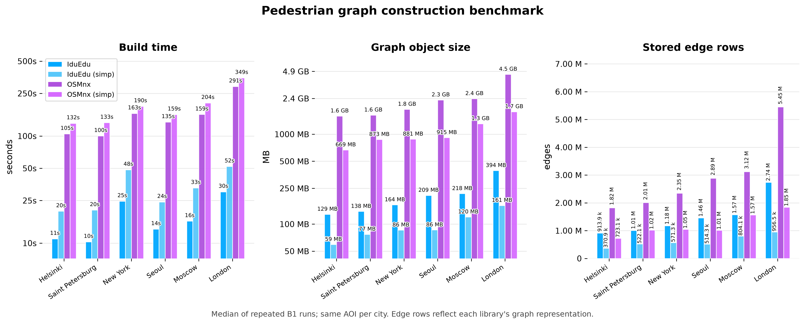

# IduEdu

[](https://github.com/psf/black)
[](https://pypi.org/project/iduedu/)
[](https://github.com/IDUclub/IduEdu/actions/workflows/quality.yml)
[](https://github.com/IDUclub/IduEdu/tree/python-coverage-comment-action-data)
[](https://opensource.org/licenses/BSD-3-Clause)
[](https://iduclub.github.io/IduEdu/)
[](https://github.com/IDUclub/IduEdu)

<p align="center">

</p>

**IduEdu** is an open-source Python toolkit for building and analyzing multimodal city networks from
OpenStreetMap and local GTFS Schedule data. It downloads OSM data via Overpass, reads GTFS feeds, builds
drive, walk, public-transport and intermodal networks, and stores them as `UrbanGraph` objects backed by
GeoDataFrame node and edge tables.

## Benchmark snapshot

The benchmark below isolates city-scale pedestrian graph construction, comparing IduEdu's tabular
`UrbanGraph` representation with OSMnx's widely used NetworkX-backed workflow on the same area of
interest for each city. Both simplification modes are shown because `simplify` changes the trade-off
between graph-construction time and the size of the resulting graph.



Across these repeated B1 runs, IduEdu built pedestrian graphs in about **6.6-10.0x less time** without
simplification and **3.9-6.7x less time** with simplification enabled. The resulting geospatial graph
object had a **10-12x lower deterministic representation-size estimate**. Edge-row counts are shown as
a representation detail:
`UrbanGraph` can keep bidirectional walking edges as one row with a direction flag, while NetworkX-style
directed multigraphs store separate directed edge rows.

Full protocol notes, limitations and raw-result links are in the
[benchmark documentation](https://iduclub.github.io/IduEdu/benchmarks.html).

## Documentation

Full documentation is published at <https://iduclub.github.io/IduEdu/>.
Migrating from the old NetworkX-first API? See the
[UrbanGraph migration guide](https://iduclub.github.io/IduEdu/migration_to_urban_graph.html).
Runnable examples are available for
[graph construction](https://iduclub.github.io/IduEdu/examples/get_any_graph.html),
[UrbanGraph basics](https://iduclub.github.io/IduEdu/examples/urban_graph_basics.html),
[object projection](https://iduclub.github.io/IduEdu/examples/objects_and_nearest_nodes.html), and
[shortest paths](https://iduclub.github.io/IduEdu/examples/shortest_paths.html). GTFS feeds are covered in
the [GTFS guide](https://iduclub.github.io/IduEdu/api/gtfs.html) and the
[GTFS example](https://iduclub.github.io/IduEdu/examples/gtfs_public_transport.html), public-transport speeds
and waits in the [transport registry guide](https://iduclub.github.io/IduEdu/api/transport_registry.html), and
every setting in the [configuration guide](https://iduclub.github.io/IduEdu/configuration.html).

## Features

- Store graph topology, geometry, CRS and edge weights in `UrbanGraph`, a GeoDataFrame-native graph model.
- Build drive and walk graphs from OpenStreetMap with local metric projection and optional simplification.
- Build static public-transport graphs directly from OSM relations for bus, trolleybus, tram, subway,
  monorail and share taxi, with trains available through `DEFAULT_REGISTRY_W_TRAIN`.
- Build static public-transport graphs from local GTFS Schedule directories or ZIP archives, using timetable
  headways for boarding weights and shapes or straight-line fallbacks for route geometry. Several feeds of
  one city can be merged with `merge_gtfs_feeds`.
- Reconstruct shortest routes as ordered nodes and edge geometries for mapping.
- Combine pedestrian and public-transport layers into one intermodal graph by projecting stops, platforms
  and station access points onto the walking network.
- Compute shortest paths and OD matrices with Numba-backed CSR routines, cutoff thresholds and adaptive
  graph reversal for unbalanced origin-destination sets.
- Work with connected, weakly connected and strongly connected UrbanGraph components.
- Convert to and from NetworkX through optional compatibility utilities.
- Snap geometries to graph nodes with `nearest_nodes` and validate custom graph edits.
- Store graphs as `.urbangraph` archives with parquet tables and metadata.
- Cache Overpass responses and query historical OSM snapshots.

## Installation

```bash
pip install iduedu
```

IduEdu supports Python 3.11 through 3.14. The core package uses the standard geospatial stack
including GeoPandas, Shapely, PyProj, NumPy, Pandas and SciPy. NetworkX utilities are optional
compatibility helpers.

Use `pip install "iduedu[io]"` to enable `.urbangraph` parquet archive read/write helpers.

Use `pip install "iduedu[pbf]"` to build the same OSM graphs offline from local `.osm.pbf` extracts (for example
Geofabrik downloads) instead of the Overpass API; see the
[configuration guide](https://iduclub.github.io/IduEdu/configuration.html).

## Quickstart

### Build an intermodal graph

```python
from iduedu import get_intermodal_graph

graph = get_intermodal_graph(
    osm_id=1114252,  # for example, Saint Petersburg's Vasileostrovsky District
    pt_kwargs={"transport_types": ["bus", "tram", "subway"]},
)

print(graph.nodes_gdf.head())
print(graph.edges_gdf.head())
```

Graph builders return `UrbanGraph`. Nodes are stored in `graph.nodes_gdf`; edges are stored in
`graph.edges_gdf` and include `u`, `v`, `geometry`, `length_meter` and `time_min`.

OSM-based boarding waits are mode-specific defaults stored in `TransportRegistry`. GTFS boarding waits are
derived from the selected feed schedule instead.

### Build a public-transport graph from GTFS

```python
from iduedu import get_gtfs_public_transport_graph

pt_graph = get_gtfs_public_transport_graph(
    "feed.zip",
    service_date="2026-08-04",
    start_time="07:00:00",
    end_time="10:00:00",
)
```

The source can be a GTFS directory, a ZIP archive, or a list of feeds to merge. See the
[GTFS guide](https://iduclub.github.io/IduEdu/api/gtfs.html) for schedule aggregation, geometry fallbacks,
single-departure handling and intermodal joining.

### Compute an OD matrix

```python
from iduedu import od_matrix

nodes = graph.nodes_gdf.index.to_list()

matrix = od_matrix(
    graph,
    origins_nodes=nodes[:5],
    destination_nodes=nodes[5:15],
    weight="time_min",
    cutoff=30,
)

print(matrix)
```

Use `weight="time_min"` for travel time in minutes or `weight="length_meter"` for distance in meters.
Pairs without a path, or outside `cutoff`, are returned as `inf`; `threshold` remains a compatible alias.

To calculate distances and routes together, use `output="both"`. Lazy storage reconstructs individual routes
without rerunning Dijkstra:

```python
result = graph.od_matrix(
    origins_nodes=nodes[:5],
    destination_nodes=nodes[5:15],
    cutoff=30,  # inclusive; threshold remains a compatible alias
    output="both",
    path_storage="lazy",
)
distances = result.distances
path = result.get_path(nodes[0], nodes[5])  # node list, or None when unreachable
paths = result.paths  # materialize and cache all requested routes
```

Use `output="paths"` for routes alone, `mode="pairwise"` to match inputs by position, and `iter_od_matrix`
to process origin rows in blocks. The general `single_source_dijkstra`, `multi_source_dijkstra` (nearest source),
and `dijkstra_parallel` (independent source rows) helpers also support selecting distances, paths, or both.
See the [routing API](https://iduclub.github.io/IduEdu/api/matrices.html) for shapes, lazy storage, and memory limits.

### Reconstruct a route

```python
from iduedu import path_to_edges

paths = graph.single_source_dijkstra(
    nodes[0], target_nodes=[nodes[-1]], weight="time_min", output="paths",
)
path = paths.loc[nodes[-1]]
route = path_to_edges(graph, path or [])

print(route[["type", "length_meter", "time_min"]])
```

Path results contain node ids in travel order, or `None` when the destination cannot be reached.
`path_to_edges` turns them into the traversed edges with their geometry, type and travel time, ready to plot.
The specialised `single_source_dijkstra_path` helper remains available and returns `[]` for an unreachable target.

### Work with graph components

```python
from iduedu import largest_component, subgraph_by_nodes

component_nodes = largest_component(graph)
main_graph = subgraph_by_nodes(graph, component_nodes)
```

## Public API

Common entry points are available directly from `iduedu`:

- Builders: `get_drive_graph`, `get_walk_graph`, `get_public_transport_graph`,
  `get_gtfs_public_transport_graph`, `get_intermodal_graph`, `join_pt_walk_graph`, `get_4326_boundary`.
- GTFS: `merge_gtfs_feeds`; `read_gtfs_feed`, `validate_gtfs_feed` and `GTFSFeed` live in `iduedu.gtfs`.
- Transport modes: `TransportSpec`, `TransportRegistry`, `DEFAULT_REGISTRY`, `DEFAULT_REGISTRY_W_TRAIN`.
- Graph model: `UrbanGraph`, `UrbanGraphChanges`.
- Editing and transforms: `clip_urban_graph`, `join_urban_graphs`, `project_objects2urban_graph`,
  `apply_urban_graph_changes`, `subgraph_by_nodes`, `relabel_urban_graph`, `simplify_multiedges`,
  `to_directed`, `to_undirected`.
- Graph utilities: `nearest_nodes`, `validate_graph`, `UrbanGraph.nearest_nodes`,
  `UrbanGraph.validate`.
- Graph IO: `read_urban_graph`, `write_urban_graph`, `UrbanGraph.read`, `UrbanGraph.write`.
- Components: `connected_components`, `weakly_connected_components`, `strongly_connected_components`,
  `largest_component`.
- Shortest paths and matrices: `single_source_dijkstra`, `multi_source_dijkstra`, `dijkstra_parallel`,
  `ShortestPathResult`, `iter_od_matrix`, `single_source_dijkstra_path`, `multi_source_dijkstra_path`, `path_to_edges`,
  `single_source_dijkstra_path_length`, `multi_source_dijkstra_path_length`,
  `multi_source_dijkstra_nearest_source`, `dijkstra_path_length_parallel`, `od_matrix`.
- Optional NetworkX helpers (install `networkx` separately): `urban_graph2nx_graph`, `nx_graph2urban_graph`,
  `graph2gdf`, `gdf2graph`, `read_gml`, `write_gml`, `clip_nx_graph`, `reproject_graph`.

## Configuration

IduEdu reads its settings from the global `config` object, and most of them also from environment variables. Use it
to point requests at another Overpass instance, pace them, cache responses, query a historical OSM snapshot, choose
the OSM tags kept on edges, or set up logging:

```python
from iduedu import config

config.set_overpass_url("https://overpass-api.de/api/interpreter")
config.set_rate_limit(min_interval=2.0, max_retries=5)
config.set_overpass_cache(cache_dir=".iduedu_cache", enabled=True)
config.set_overpass_date(date="2020-01-01")  # query OSM as it stood on this date
config.configure_logging(level="INFO")
```

See the [configuration guide](https://iduclub.github.io/IduEdu/configuration.html) for every setting and its
environment variable.

## Development

This project uses `uv`.

```bash
uv sync --all-groups
```

Useful commands:

```bash
make test           # fast tests, no network
make test-network   # Overpass/network tests
make test-all       # all tests
make coverage       # terminal coverage for fast tests
make coverage-xml   # CI coverage, includes network tests
make format-check
make lint
make docs
```

See [CONTRIBUTING.md](CONTRIBUTING.md) for the full development, testing, Conventional Commits and
release workflow.

## Releases

Releases are automated from Conventional Commit messages on the official `IDUclub/IduEdu` `main` branch
using python-semantic-release.
Do not bump versions or create tags manually. The single source of truth for the package version is
`iduedu/_version.py`; `pyproject.toml` reads it dynamically at build time.

## Contacts

- [NCCR](https://actcognitive.org/) - National Center for Cognitive Research
- [IDU](https://idu.itmo.ru/) - Institute of Design and Urban Studies
- [Natalya Chichkova](https://t.me/nancy_nat) - project manager
- [Danila Oleynikov (Donny)](https://t.me/ddonny_dd) - lead software engineer

## Acknowledgments

Реализовано при финансовой поддержке Фонда поддержки проектов Национальной технологической инициативы
в рамках реализации "дорожной карты" развития высокотехнологичного направления "Искусственный интеллект"
на период до 2030 года (Договор № 70-2021-00187)

This research is financially supported by the Foundation for National Technology Initiative's Projects
Support as a part of the roadmap implementation for the development of the high-tech field of Artificial
Intelligence for the period up to 2030 (agreement 70-2021-00187)

---

## License

IduEdu is distributed under the BSD 3-Clause License. See [LICENSE.txt](LICENSE.txt) for details.

---

## Citing IduEdu

If you use IduEdu in research, please cite it. Citation metadata is kept in [`CITATION.cff`](CITATION.cff); on
GitHub, **Cite this repository** in the repository sidebar copies it as APA or BibTeX. Publications describing
IduEdu will be listed below.

## Publications

_Coming soon..._
